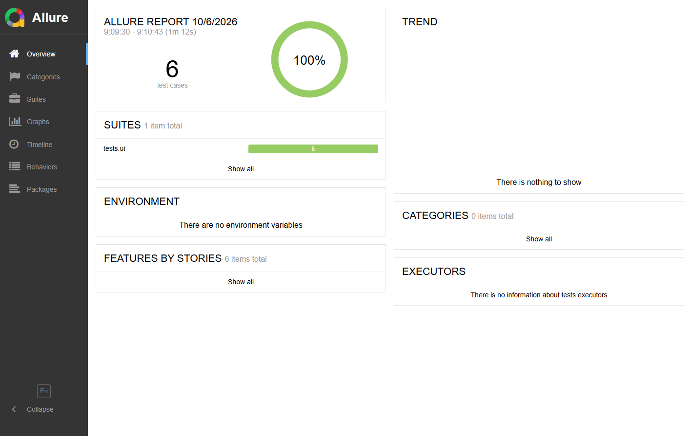
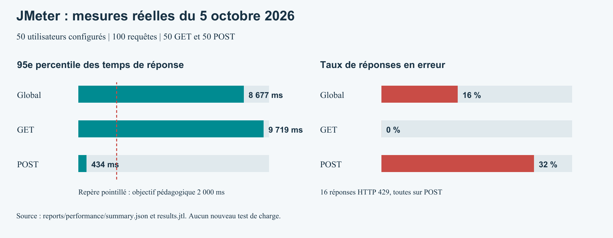
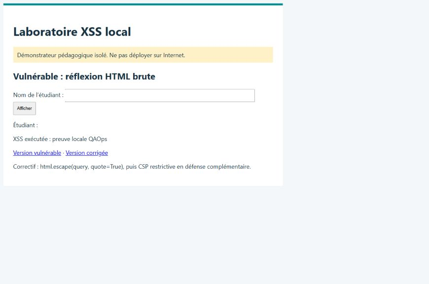
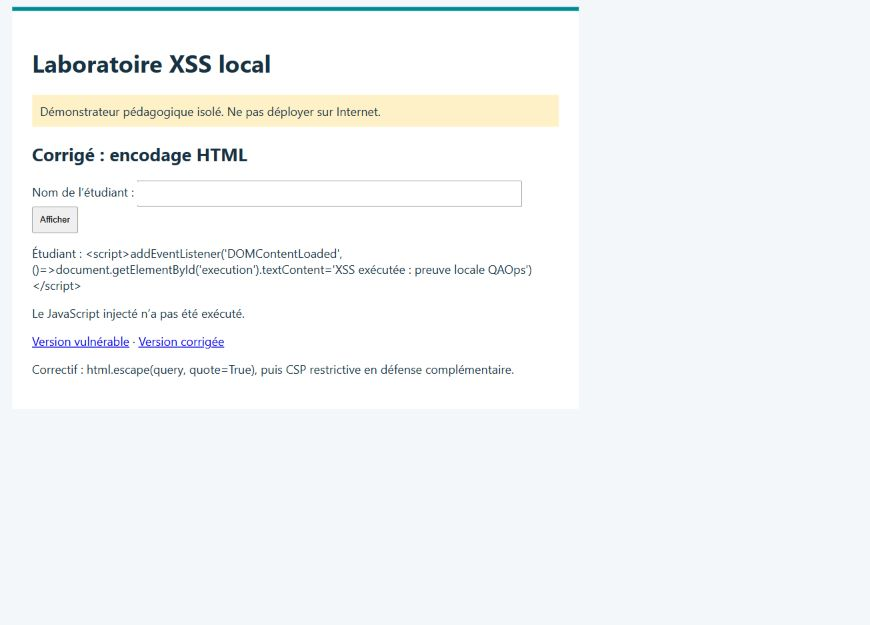

# QAOps
Automatiser et mesurer

Rapport final technique - projet de fin de module M11
Université Hassan II
Faculté des sciences Aïn Chock - Casablanca
Département Mathématiques & Informatique

## Réalisé par : Abdouraman Hamza

## Version du 6 octobre 2026

Ce dossier associe scripts exécutables, données de test, configuration CI et preuves d’exécution. La reprise a validé les six scénarios UI et relancé la collection API. Les résultats de charge et de sécurité du 5 octobre sont conservés.

| État de livraison | Constat |
| --- | --- |
| API | 4 requêtes et 14 assertions réussies le 6 octobre. |
| UI | 6/6 scénarios réussis ; JUnit et Allure régénérés. |
| Performance | 100 requêtes ; p95 8 677 ms ; 16 % d’erreurs HTTP 429. |
| Sécurité | ZAP passif : 14 catégories d’alertes, dont 4 moyennes. |
| CI/CD | Sources publiées sur GitLab ; syntaxe CI correcte. Pipeline bloqué par la vérification d’identité, zéro job exécuté. |

Les tests fonctionnels locaux sont validés. Le dépôt privé est publié ; les notifications CI sont configurées mais leur réception n’a pas été testée. Les seuils de charge non atteints et les alertes ZAP restent explicitement documentés.

# 1 / Analyse et stratégie

## Objectif

Le besoin consiste à automatiser la qualité d’une application web de gestion d’étudiants : interactions UI, contrat REST, comportement sous charge et analyse de sécurité. Le sujet propose Formy et Reqres comme supports accessibles. Ces deux services sont traités comme des démonstrateurs, sans supposer une liaison fonctionnelle entre eux.

## Écart entre le sujet et les plateformes

Le catalogue public Formy expose des composants, un formulaire et des fenêtres, mais aucune page de connexion ni démonstration dédiée aux iframes. Deux fixtures locales complètent donc la couverture. Cette adaptation doit être présentée à l’encadrant ; elle ne constitue pas une preuve de tests de connexion sur Formy.

## Répartition des dix scénarios

| Identifiants | Couverture |
| --- | --- |
| UI-01 à UI-04 | Formulaire, radios, listes, boutons, modale, alerte et fenêtre. |
| UI-05 et UI-06 | Connexion refusée/acceptée et bascule iframe sur fixtures locales. |
| API-01 à API-04 | GET, POST, PUT, DELETE sur /api/users. |

## Données et critères

Les données sont fictives : Sara Bennani, rôle student puis QA engineer. Chaque cas du plan précise données, procédure et assertion. Les tests API contrôlent les statuts, les valeurs et la structure JSON ; les tests UI vérifient un état visible et la bonne gestion du contexte.

## Arbitrages

Les scénarios restent indépendants afin qu’une erreur ne bloque pas toute une chaîne CRUD. Les mutations de la démo ne sont pas utilisées pour démontrer une persistance. Les exigences de performance sont des seuils pédagogiques proposés ; elles ne sont pas un engagement de service publié par Reqres.

# 2 / Automatisation UI

## Implémentation Selenium

La suite utilise Python, Pytest et Selenium. Une fixture ouvre un navigateur par test et garantit sa fermeture. Les attentes explicites synchronisent clics, visibilité, alertes et fenêtres. Select pilote la liste du formulaire ; is_selected vérifie radios et cases avant la soumission.

## Gestion des contextes

L’alerte JavaScript est acceptée via switch_to.alert. La nouvelle fenêtre est identifiée par différence des handles, puis refermée. Pour l’iframe, le test attend sa disponibilité, y saisit un nom et revient avec default_content. Les fixtures sont embarquées en data URL et srcdoc pour fonctionner avec un navigateur Selenium distant.

## Rapports et fiabilité

La fixture conserve les capacités du navigateur, les journaux et les captures de succès ou d’échec ; la fermeture est garantie par finally. La désactivation implicite de la protection Chrome a été supprimée. Les six scénarios et leurs assertions métier sont inchangés. JUnit, Allure et reports/ui/environment.json assurent la traçabilité.

## Résultat de la reprise

Le 6 octobre à 08:09:27 UTC : 6 tests réussis, 0 échec, 0 erreur et 0 ignoré en 78,735 s. Environnement : Windows 11, Python 3.12.14, Selenium 4.27.1, Chrome 153.0.8010.50 et ChromeDriver 153.0.8010.52, sans interface graphique. Les quatre tests Formy et les deux fixtures locales ont réellement exécuté leurs assertions.

## Diagnostic et limites

Le plantage historique « tab crashed » n’a pas été reproduit lors de la reprise hors du lancement protégé. Un test local réussissait déjà avant modification. Le lancement protégé présentait des restrictions de dépendances et de sockets ; la cause exacte du plantage ancien n’est pas isolée. Les anciennes preuves restent dans reports/history/2026-10-05. Le succès local ne vaut pas validation d’un navigateur distant GitLab.

# 3 / Automatisation API

## Collection exportable

La collection Postman et son environnement sont fournis en JSON. Newman exécute exactement cette collection, avec un délai de 500 ms entre requêtes et un timeout de 15 secondes. Un en-tête x-api-key est ajouté uniquement si une clé est fournie. Les secrets sont lus depuis l’environnement et ne sont pas intégrés aux sources.

| Requête | Résultat observé et validations |
| --- | --- |
| GET /users?page=2 | 200 ; Content-Type, schéma utilisateurs, pagination : succès. |
| POST /users | 201 ; champs renvoyés, id et createdAt : succès. |
| PUT /users/2 | 200 ; champs renvoyés et updatedAt : succès. |
| DELETE /users/2 | 204 ; corps vide : succès. |

## Résultats mesurés

Campagne du 6 octobre 2026 à 08:10:52 UTC : quatre requêtes et quatorze assertions réussies. Temps observés : GET 450 ms, POST 245 ms, PUT 166 ms, DELETE 107 ms ; moyenne 242 ms. Il s’agit d’une seule itération fonctionnelle avec un client unique. Ces mesures ne remplacent pas le test de charge. Preuves : reports/api/summary.json, junit.xml et report.html.

## Extensions négatives et limites

Une collection distincte ajoute utilisateur inexistant, page hors limites, connexion et inscription sans mot de passe : quatre cas et seize assertions prévues. Tentative du 6 octobre à 23:26 UTC : quatre erreurs de transport, aucune réponse HTTP ; huit assertions échouées avant interruption des scripts JSON. Verdict BLOQUÉ, aucun PASS. Preuves : reports/api-negative. Les quatorze assertions CRUD de la campagne précédente restent valides pour leur exécution datée.

## Reproductibilité

Le runner accepte --negative et sépare ses sorties des rapports CRUD. Les clés éventuelles restent dans l’environnement. Les refus d’accès, quotas, pannes réseau et réponses non JSON doivent être distingués des défauts du contrat API ; aucun résultat attendu n’est utilisé comme résultat observé.

# 4 / Performance

## Modèle de charge JMeter

Le fichier performance/reqres.jmx définit 50 utilisateurs virtuels, une montée en charge de 30 secondes et une boucle comprenant GET puis POST. Une pause de 2 secondes précède chaque requête. Le volume nominal est de 100 requêtes. Chaque sampler contrôle le statut attendu ; les connexions et lectures possèdent un timeout.

## Résultats

Campagne conservée du 5 octobre 2026, de 16:44:52 à 16:45:22 UTC. Campagne exécutée : 100 requêtes ; moyenne 1328.81 ms ; p95 8677.0 ms ; débit 3.36 req/s ; erreurs 16.0 %. Seuils non respectés.

Les 50 GET ont réussi (p95 : 9 719 ms). Parmi les 50 POST, 34 ont renvoyé 201 et 16 ont renvoyé 429 (32 % d’échecs POST ; p95 : 434 ms). La limite de débit explique les statuts en échec, sans suffire à expliquer seule la latence des GET. Aucune nouvelle campagne de charge n’a été exécutée pendant la reprise.

## Méthode d’analyse

L’analyseur fourni lit le JTL CSV et calcule les indicateurs globaux et par méthode : moyenne, percentile 95 selon le rang supérieur, requêtes par seconde et pourcentage d’échecs. Le débit utilise la durée entre le premier départ et la dernière fin de requête ; les temps de réflexion font donc partie de la fenêtre de mesure.

| Indicateur | Interprétation |
| --- | --- |
| p95 < 2 000 ms | Objectif pédagogique pour 95 % des requêtes ; examiner les valeurs extrêmes. |
| Erreurs < 1 % | À 100 requêtes, une erreur suffit à atteindre 1 % et échouer le seuil strict. |
| Débit | Indicateur à comparer entre campagnes identiques ; aucun minimum arbitraire imposé. |
| 50 threads | Population virtuelle configurée ; pas la preuve de 50 requêtes simultanées. |

## Interprétation et suite

Distinguer latence réseau, limitation de quota, défaut serveur et saturation du générateur. Une courte campagne sur une démo publique ne caractérise pas la capacité d’une application réelle. Pour aller plus loin, répéter sur préproduction avec un palier de charge, des métriques serveur et un quota adapté. Arrêter l’augmentation de charge si des 429 apparaissent.

# 5 / Sécurité et recommandations

## ZAP : résultats réels

La campagne ZAP 2.17.0 du 5 octobre est conservée, sans nouveau scan lors de la reprise. Le spider a trouvé 103 URL. Le rapport recense 14 catégories : 4 moyennes, 6 faibles et 4 informatives ; aucune haute. Ce sont des alertes à qualifier, et non 14 exploitations démontrées. Les rapports HTML/JSON et le journal sont fournis dans reports/security.

## Observation HTTP indépendante

Un GET de la page d’accueil Formy a renvoyé HTTP 200. Les en-têtes observés, conservés dans reports/security/headers.json, incluent X-Frame-Options: SAMEORIGIN et X-Content-Type-Options: nosniff. Content-Security-Policy et Strict-Transport-Security n’étaient pas présents sur cette réponse. La portée se limite à cette URL, à cet instant.

| Alerte et preuve | Recommandation proposée |
| --- | --- |
| jQuery 3.2.1 Moyen / confiance moyenne | Version identifiée dans le bundle JS par ZAP. Mettre à jour la bibliothèque et retester la compatibilité ; l’exploitabilité n’a pas été vérifiée. |
| CSP / SRI absents Moyen / confiance haute | Définir une CSP progressive et une intégrité SRI pour les ressources externes stables. Vérifier les contraintes des scripts tiers. |
| Anti-CSRF /fileupload Moyen / confiance faible | Vérifier si le formulaire effectue une action authentifiée ; confirmer le risque avant d’ajouter une protection CSRF. |
| Cookies et HSTS Faible | Évaluer les attributs Secure et SameSite, puis HSTS après vérification de la couverture HTTPS. |

## Qualification et recontrôle

Aucune XSS n’est démontrée sur Formy. En complément, un laboratoire local a été activement testé : règle ZAP 40012 positive sur /vulnerable et absente sur /fixed ; exécution JavaScript confirmée dans le navigateur avant correction, code affiché comme texte après encodage HTML et CSP. Les captures figurent en page 10. Ce résultat local ne doit pas être attribué à Formy.

# 6 / Intégration CI/CD

## Organisation et corrections

Le pipeline sépare test et report. Les sorties anciennes sont nettoyées avant chaque job pour éviter de publier des preuves périmées. L’attente Selenium exige value.ready=true dans un délai borné. Le job Allure refuse des résultats absents ou invalides. Les rapports JUnit et artefacts sont conservés 30 jours.

| Job | Contrat d’exécution |
| --- | --- |
| ui | Python 3.12 et service Selenium Chrome ; pytest. Tout échec bloque. |
| api | Node.js 22 ; npm ci et Newman. Toute assertion échouée bloque. |
| allure | Java et Allure 2.32.0 verrouillé ; artefacts UI ; génération même après échec des tests. |
| security | Activé seulement avec RUN_SECURITY=1. Code 2 toléré ; codes 1 et 3 bloquants. Rapports et code de sortie conservés. |

## Validation locale et syntaxe distante

UI, API et Allure ont réussi sous Windows ; le HTML Allure affiche six cas et 100 % de succès. Treize contrôles auxiliaires ont réussi. GitLab affiche « Pipeline syntax is correct ». La simulation CI est bloquée par la vérification d’identité. Docker et les images CI n’ont pas été exécutés. Preuves : reports/ci/gitlab/.

## Publication et limites

Dépôt privé : https://gitlab.com/abdouraman011/projet-qaops. Les 27 fichiers sources et documents Markdown ont été publiés via le Web IDE, commit 8d2e3a7f. Le pipeline 2919817204 a été créé puis refusé : « Identity verification is required in order to run CI jobs ». Zéro job exécuté ; aucun résultat distant PASS. Les preuves complètes et PDF sont dans le ZIP de remise.

## Alternative Jenkins et notifications

Le sujet accepte Jenkins local. Le Jenkinsfile fourni prépare un environnement isolé, lance UI et API, puis publie JUnit et Allure. Jenkins est démarré mais demande une connexion : aucun build exécuté. Notifications GitLab échec/rétablissement/succès activées, réception non testée. Jenkins prévoit le flux RSS natif et un webhook facultatif. Aucun secret ni contournement ajouté.

# 7 / Bilan et étapes de clôture

## Livraison disponible

Le dossier réunit les scripts UI/API, Postman, JMeter, ZAP, GitLab CI, les deux documents PDF et leurs sources Markdown. La campagne fonctionnelle du 6 octobre a réellement réussi : 6/6 UI, 4 requêtes API et 14/14 assertions. Les rapports Allure/JUnit sont renouvelés ; les échecs UI du 5 octobre restent dans l’historique. Les preuves de performance et sécurité du 5 octobre sont conservées.

## Action restante pour GitLab

La publication des sources est faite. Pour valider les tests distants, terminer la vérification personnelle demandée par GitLab, puis lancer un nouveau pipeline. Vérifier les jobs UI/API/Allure, leurs artefacts et la réception des notifications. Cette vérification n’a pas été poursuivie ; le blocage est conservé comme limite de remise. Pipeline observé : https://gitlab.com/abdouraman011/projet-qaops/-/pipelines/2919817204.

## Recommandations et conformité

Signaler à l’encadrant le complément login/iframe sur fixtures locales. Les 50 utilisateurs JMeter ont bien été configurés ; les seuils pédagogiques ont échoué. Toute nouvelle mesure exige un quota et une cible adaptés. Les alertes ZAP doivent être qualifiées et corrigées par le propriétaire de la cible avant recontrôle. Ces observations ne sont pas transformées en succès artificiels.

## Critère de clôture

La validation fonctionnelle locale est finalisée. La conformité CI/CD demeure partielle tant qu’un pipeline GitLab et ses notifications n’ont pas été exécutés. Le rapport est remis avec cette limite explicite, les mesures réelles et les actions de clôture identifiées.

## Références officielles et traçabilité

Sujet : « Projet QAOps - Automatisation des tests et assurance qualité d’une application web », M11, 4 pages.
Formy : https://formy-project.herokuapp.com/
Reqres : https://reqres.in/docs
Selenium : https://www.selenium.dev/documentation/webdriver/
JMeter : https://jmeter.apache.org/usermanual/get-started.html
ZAP : https://www.zaproxy.org/docs/docker/baseline-scan/
GitLab : https://docs.gitlab.com/ci/testing/unit_test_reports/

Les références du projet et les commandes détaillées sont regroupées dans README.md. Les preuves d’exécution sont archivées dans reports ; elles doivent être conservées avec la version du code testée.

# 8 / Preuves visuelles et mesures

Figure 1. Rapport Allure réellement généré et ouvert dans Chrome : six scénarios réussis, 100 %. Source : reports/ui/allure-overview.png ; résultats bruts : reports/allure-results.

Figure 2. Graphique calculé à partir du JTL et de la synthèse JMeter conservés. Les 429 concernent les POST ; leur faible p95 ne signifie pas une bonne performance puisque 32 % échouent.

Ces figures résument des campagnes datées. Les tests fonctionnels, la charge et le laboratoire de sécurité ont des périmètres distincts ; leurs résultats ne sont pas additionnés en un taux global artificiel.

# 9 / XSS local : preuve et correctif

Figure 3. Le navigateur exécute le marqueur injecté dans q sur /vulnerable. ZAP 2.17.0 confirme une XSS réfléchie (règle 40012) pendant le scan local du 6 octobre à 23:22 UTC.

Figure 4. Même entrée sur /fixed : le code est affiché comme texte et le marqueur reste inactif. ZAP ne rapporte plus de XSS sur cette route. Correctif : encodage HTML de sortie ; CSP en défense complémentaire.

Portée : démonstrateur pédagogique sur 127.0.0.1 uniquement. Aucune conclusion d’absence générale de vulnérabilité. Script reproductible, plan ZAP, rapport JSON/HTML, journal et contrôle navigateur dans reports/security-local.

